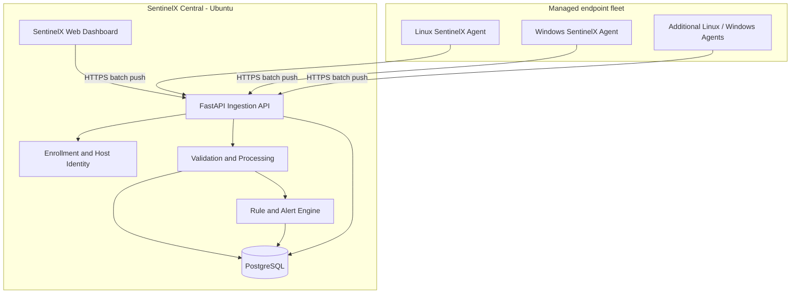

# SentinelX Independent Monitoring Architecture

**Status:** Approved product direction; implementation blueprint for `cross-platform-v1`  
**Product rule:** SentinelX owns collection, transport, storage, processing, alerting, and visualization. Do not add Prometheus, Node Exporter, Windows Exporter, or Grafana as runtime dependencies.

## 1. Product outcome

One SentinelX central console monitors a fleet of Linux and Windows machines. Each endpoint runs a lightweight SentinelX agent. Operators use only the SentinelX dashboard to view live status, historical performance, storage capacity, services, processes, file activity, security events, and alerts.

The agent uses a **push model**: it collects locally and sends authenticated, batched telemetry to the central API. Endpoints do not expose scrape ports.

## 2. Logical architecture



### Central components

- **Agent:** platform-specific collection, bounded inventory, file watches, local retry queue, heartbeat, batching.
- **Ingestion API:** authenticate host, validate schema and size, accept batches, apply rate limits, return acknowledgement.
- **Host registry:** stable host ID, hostname, OS/build, agent version, group, lifecycle state, last-seen time.
- **Metrics processor:** normalize units and names, validate timestamps, update latest snapshot, write historical samples.
- **Rule engine:** threshold and state-transition rules; create, deduplicate, acknowledge, and resolve alerts.
- **Storage:** PostgreSQL for host inventory, configuration, alerts, events, and time-series samples with indexes/partitioning/retention.
- **Dashboard:** first-party SentinelX UI for fleet overview, host detail, trends, inventory, events, alerts, and reports.

## 3. Collection contract

Use a versioned envelope. Keep existing `host_id`, `metrics`, and `events` fields compatible during migration.

Example (illustrative contract, not a claim that every collector currently emits every field):

```json
{
  "schema_version": 1,
  "host_id": "stable-agent-id",
  "agent": {"version": "0.2.0", "platform": "Windows", "architecture": "64bit"},
  "collected_at": "2026-10-31T12:00:00Z",
  "sequence": 1234,
  "metrics": {
    "cpu": {"percent": 18.4, "logical_cores": 4},
    "memory": {"total_bytes": 17179869184, "used_bytes": 8589934592, "percent": 50.0},
    "disk": {},
    "network": {},
    "processes": [],
    "services": []
  },
  "events": []
}
```

Contract rules:

1. Use UTC timestamps and explicit byte/percent/seconds units.
2. Missing or permission-denied metrics are `null`/unavailable with a reason, never fabricated zeroes.
3. Bound payload bytes, process/service inventory sizes, event count, and string lengths.
4. Include a sequence or batch ID so retries can be idempotent.
5. Agent must retain an acknowledged/unacknowledged local queue and delete only after a successful response.
6. Avoid collecting secrets, file contents, or unrestricted command output.
7. Do not send every process/service record on every interval; separate full inventory cadence from lightweight performance samples.

## 4. Data model and query strategy

Keep PostgreSQL as the initial datastore; do not introduce another monitoring product or database in the first implementation.

Recommended logical tables:

- `hosts`: one row per enrolled endpoint; unique stable host ID; OS identity, agent version, group, created/last-seen, revoked/disabled status.
- `host_latest_metrics`: one current snapshot per host for fast fleet overview.
- `metric_samples`: append-only time-series samples (host, metric key, dimensions, timestamp, numeric value); partition by time after volume warrants it.
- `security_events`: existing event history, indexed by host/time/severity/type.
- `alerts`: rule, host, severity, state, first/last occurrence, acknowledgement and resolution metadata.
- `agent_credentials`: per-host credential hash/metadata, rotation and revocation state; never store plaintext credentials.
- `audit_events`: administrative changes and sensitive actions.
- `collection_status`: per-host collector health and unavailable reasons.

Do not store high-frequency samples only inside one large JSON document if the dashboard needs efficient filtering and aggregation. JSON can remain for flexible raw snapshots during transition; promote commonly queried metrics to typed rows/columns.

### Initial retention policy (configurable)

- Raw metric samples: 7-30 days, depending on sampling interval and disk budget.
- 1-minute rollups: 30-90 days.
- 1-hour rollups: 6-13 months.
- Security events and audit records: separate policy; do not silently delete with metric retention.

Start with a single configurable retention job and database backups. Validate actual storage growth before promising a fleet size.

## 5. Scale and reliability

- Default metric interval: 30 seconds, configurable per host/group; allow slower intervals for low-value endpoints.
- Use one compressed/batched request per collection cycle; set maximum payload size and request timeout.
- Retry with exponential backoff and jitter; persist a bounded local queue across restarts. The current implementation persists one immutable in-flight batch in a local SQLite outbox and retries it until acknowledged; bounded multi-batch buffering and backoff/jitter remain follow-up work.
- Enforce per-host and global ingestion limits.
- Use database connection pooling, indexes, pagination, bounded query windows, and pre-aggregated rollups.
- Fleet dashboard reads latest snapshots, not a full scan of all historical telemetry.
- Historical chart endpoints require host, metric, start/end, and bounded resolution.
- Add background workers only when measured ingestion/aggregation work needs them.
- Load-test with representative payload sizes and sampling rates before stating capacity (for example, 100 or 1,000 endpoints).

## 6. Dashboard information architecture

1. **Fleet overview:** total/online/offline/degraded hosts, critical alerts, CPU/memory/disk summary, recent incidents.
2. **Hosts:** searchable/filterable inventory, OS, version, agent version, group, last seen, collection status.
3. **Host details:** health, uptime, CPU, memory, swap, disk volumes, network interfaces, process inventory, services.
4. **Storage:** volume usage, free bytes, thresholds, historical growth, filesystem and mount details.
5. **Network:** per-interface bytes/packets/errors and derived throughput over a selected time window.
6. **Processes and services:** bounded sortable inventory; service state transitions.
7. **File integrity:** watched paths, create/modify/delete events, hashes where safe and configured.
8. **Security center:** authentication events, Defender/ClamAV status, event filters and collection availability.
9. **Alerts:** severity, open/acknowledged/resolved states, deduplication, notes and audit trail.
10. **Reports and settings:** CSV export, retention, thresholds, collection intervals, host groups and enrollment.

All displayed states must derive from received telemetry. A host is offline only after a configurable heartbeat timeout. Distinguish offline from collection failure.

## 7. Security boundaries

- Keep the current production API bound to localhost until the secure network path is intentionally configured.
- Use HTTPS with certificate verification for remote agents.
- Replace the prototype shared token with short-lived, one-time enrollment and unique per-host credentials.
- Hash credentials at rest; support rotation and immediate revocation.
- Authenticate dashboard users and protect all host/event/summary/history endpoints.
- Authorize administrative actions; record them in audit events.
- Limit request size, event count, inventory size, query windows, and per-host request rate.
- Do not expose API or dashboard to the public internet without TLS, authentication, firewall controls, backups, and review.

## 8. Implementation sequence

### Phase A — Preserve compatibility and define contracts
- Add versioned telemetry envelope while accepting the existing payload.
- Add stable host metadata and collection status.
- Add schema tests and payload size/count limits.
- Keep current Linux agent ingestion working.

### Phase B — Reliable agent transport
- Add persistent bounded local queue, batch IDs, retry/backoff, and acknowledgement semantics.
- Separate fast metrics from slower inventories.
- Add agent version and collector availability to heartbeat.

### Phase C — Metrics storage foundation
- Add Alembic migrations.
- Create host registry, latest snapshot, typed metric sample and rollup structures.
- Add indexes, bounded query endpoints, retention job, and backup/restore test.
- Migrate dashboard reads incrementally; preserve existing API routes during transition.

### Phase D — First-party dashboard
- Fleet summary and host list.
- Host detail with CPU, RAM, disk and network history.
- Process/service inventory, file/security events and alert workflows.
- Pagination, filtering, date windows and CSV export.

### Phase E — Fleet deployment
- Linux Ansible role/playbook plus manual shell installer.
- Windows PowerShell installer and Windows service.
- Host groups, enrollment, upgrades, uninstall and status verification.

### Phase F — Scale validation and release
- Test Linux and Windows endpoints together.
- Test network interruption, agent restart, duplicate batch, revoked credentials and DB recovery.
- Load-test increasing fleet sizes; measure ingestion latency, DB growth, dashboard response and queue drain.
- Release only after CI and real Windows Server integration tests pass.

## 9. Immediate next engineering tasks

1. Inspect and test the current API/dashboard routes and agent payload on `cross-platform-v1`.
2. Add schema/version and host metadata without breaking the existing agent.
3. Add host/latest-snapshot read model and bounded fleet queries.
4. Add migrations before changing production schema.
5. Keep production `main` and the running Ubuntu deployment untouched until explicit approval.
