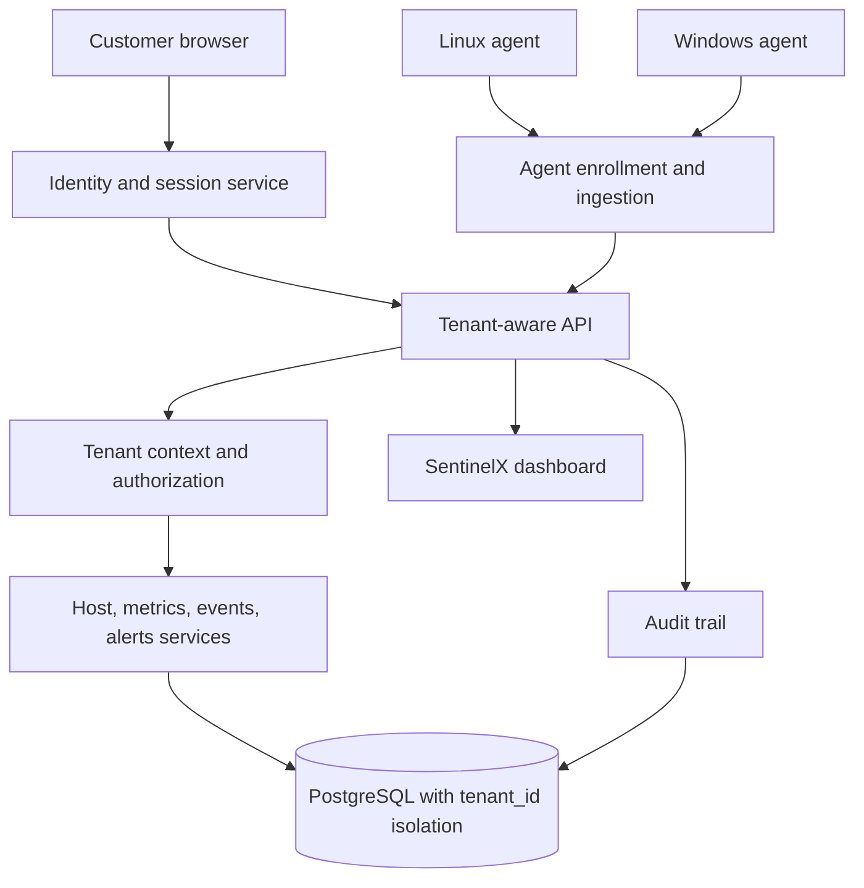

# SentinelX Multi-Customer SaaS Architecture

**Decision:** SentinelX will support multiple independent customer organizations (tenants) on one centrally operated platform.
**Development branch:** `cross-platform-v1`.
**Non-negotiable:** A customer must never read, modify, enroll, or administer another customer's users, hosts, telemetry, events, alerts, credentials, or settings.

## 1. Customer experience

1. A company registers and verifies its email.
2. The first account becomes that organization's Owner.
3. The Owner invites members and assigns roles.
4. The company creates an enrollment token with an expiry and permitted host group.
5. Linux/Windows agents enroll using that one-time token and receive a unique host credential.
6. The agent pushes signed/authenticated telemetry to SentinelX over HTTPS.
7. Users see only the hosts and data belonging to their organization.
8. The Owner can revoke a host credential or member account immediately.

## 2. Tenant-aware architecture

Use one shared application deployment initially, with logical data isolation by tenant. A separate database/schema per tenant is not required for the first SaaS release, but the design should permit enterprise isolation options later.

## 3. Core tenant data model

Every tenant-owned record must carry a non-null `tenant_id` and be scoped through a verified tenant context. Suggested tables:

- `tenants`: id, name, slug, status, plan, created_at.
- `users`: id, email, password_hash or external identity reference, status, created_at.
- `tenant_memberships`: tenant_id, user_id, role, status, invited_by, created_at; unique (tenant_id,user_id).
- `hosts`: tenant_id, host_id, hostname, platform, agent_version, group_id, status, last_seen_at; unique (tenant_id,host_id).
- `host_groups`: tenant_id, id, name, policy.
- `enrollment_tokens`: tenant_id, token_hash, expires_at, created_by, used_at, revoked_at, allowed_group_id.
- `agent_credentials`: tenant_id, host_id, credential_hash, issued_at, last_used_at, expires_at, revoked_at.
- `host_latest_metrics`: tenant_id, host_id, snapshot, collected_at.
- `metric_samples`: tenant_id, host_id, metric_key, dimensions, timestamp, value.
- `security_events`: tenant_id, host_id, event fields, occurred_at.
- `alerts`: tenant_id, host_id, rule, severity, state, acknowledgement/resolution fields.
- `audit_events`: tenant_id, actor_user_id, action, resource_type/id, timestamp, safe metadata.
- `tenant_settings`: tenant_id, thresholds, intervals, retention, feature settings.

Use composite foreign keys where practical, e.g. (`tenant_id`, `host_id`) references the matching tenant-owned host, so a row cannot accidentally link to another tenant's host.

## 4. Isolation and authorization rules

- Never trust a tenant ID supplied in a query parameter, request body, hostname, or agent payload as proof of access.
- For browser requests, derive tenant context from the authenticated user's active membership, then verify role and resource ownership on every request.
- For agent requests, resolve tenant and host from the unique credential record. Do not accept tenant identity from the agent payload.
- Every database query, update, delete, aggregate, export, and background job must include tenant scope.
- Use PostgreSQL Row-Level Security (RLS) as defense in depth where compatible with connection pooling; set tenant context transaction-locally and test context reset between pooled requests.
- Return 404 for resources outside the caller's tenant where that avoids resource enumeration; do not reveal another tenant's existence.
- Cross-tenant administrative support access must be exceptional, time-limited, reason-recorded, and audited.
- Never place a global agent token or customer secret in browser JavaScript.

## 5. Identity, roles, and sessions

Initial roles:

- **Owner:** manage billing/plan, organization, members, enrollment, all hosts, policies, and audit records.
- **Admin:** manage members (except ownership transfer), hosts, groups, enrollment, settings, and alerts.
- **Operator:** view assigned hosts, investigate events, acknowledge/resolve alerts according to policy.
- **Viewer:** read-only access to permitted hosts, dashboards, and reports.

Use secure password hashing (Argon2id or bcrypt with appropriate parameters), verified email, rate-limited login, secure HttpOnly/Secure/SameSite cookies, CSRF protection for cookie-authenticated state changes, session expiry and revocation, and MFA as a later/required production hardening milestone. Prefer a well-maintained identity provider if the team does not want to own password recovery and MFA.

## 6. Agent enrollment and credentials

- An Owner/Admin creates a short-lived, single-use enrollment token for a tenant.
- Store only a cryptographic hash of the token.
- Enrollment exchanges the token for a unique per-host credential; atomically mark the token used.
- Store only a hash of the agent credential centrally; show it only once if needed.
- Bind the credential to tenant_id and host_id server-side.
- Support credential rotation and immediate revocation.
- Agent requests use TLS with certificate verification and bounded payloads/rate limits.
- Keep the existing shared-token prototype limited to controlled testing; it is not acceptable for public multi-customer operation.

## 7. API shape

Browser APIs should be tenant-scoped from the authenticated session, for example:

- `GET /api/v1/me`
- `GET /api/v1/tenants/current`
- `GET /api/v1/hosts`
- `GET /api/v1/hosts/{host_id}`
- `GET /api/v1/hosts/{host_id}/metrics?metric=cpu&from=...&to=...`
- `GET /api/v1/events`
- `GET /api/v1/alerts`
- `POST /api/v1/alerts/{alert_id}/acknowledge`
- `POST /api/v1/enrollment-tokens`
- `POST /api/v1/members/invitations`

Agent APIs:

- `POST /api/v1/agent/enroll` (one-time enrollment token)
- `POST /api/v1/agent/telemetry` (unique host credential)
- `POST /api/v1/agent/heartbeat`
- `POST /api/v1/agent/credential/rotate`

Existing `POST /api/v1/telemetry` and current GET routes must remain backward-compatible during a controlled migration, but must not be exposed to untrusted customers with a global shared token or unauthenticated reads.

## 8. Plans, quotas, and noisy-neighbor controls

Represent plans and limits per tenant, but do not invent commercial pricing until measured:

- Maximum enrolled hosts.
- Collection interval minimum.
- Metric/event ingestion rate and payload size.
- Retention period and report/export limits.
- User/member count.
- API request rate and concurrent operations.

Enforce quotas centrally and return clear 429/limit responses. Use per-tenant usage counters and alert on abnormal ingestion. Ensure one noisy tenant cannot exhaust database connections, worker capacity, or storage for everyone.

## 9. Safe migration plan

1. **Inventory existing schema and routes.** Record current production assumptions; do not change the live database yet.
2. **Design migrations.** Add tenants, users, memberships and tenant_id to every tenant-owned table. Backfill the existing installation into one initial tenant (the current owner organization) before making tenant_id non-null.
3. **Add authorization dependencies.** Resolve authenticated user, active tenant membership, role, and resource ownership on every browser endpoint.
4. **Add enrollment.** Implement one-time tokens and unique host credentials; bind each existing host to the initial tenant.
5. **Add RLS and isolation tests.** Test two tenants against every list/detail/history/event/alert/export/update route, including guessed IDs and pooled DB connections.
6. **Add customer UI.** Registration, login, organization switcher, member invitations, roles, host enrollment and revocation.
7. **Add quotas and audit.** Meter host count and ingestion; audit membership, credential, settings, and alert actions.
8. **Security review and staging.** Verify TLS, CSRF, password/session controls, rate limits, backups, restore, tenant deletion/export, and incident response before public signup.

## 10. Mandatory acceptance tests

Create at least Tenant A and Tenant B in automated tests:

- A cannot list or read B's hosts, samples, events, alerts, users, groups, or audit entries.
- A cannot update/delete/acknowledge/export B's resources even if it knows the IDs.
- A's agent credential cannot submit telemetry for B's host or tenant.
- B's enrollment token cannot enroll a host into A.
- Revoked/expired/used enrollment tokens fail.
- Revoked host credentials fail immediately.
- Tenant context does not leak between requests using pooled database connections.
- Aggregations, search, pagination, CSV exports, background jobs, and alert rules remain tenant-scoped.
- A platform support action is denied unless explicitly authorized and fully audited.

## 11. Immediate implementation order

1. Inspect current SQLAlchemy models, API routes, dashboard fetch logic, and tests on `cross-platform-v1`.
2. Write a schema migration plan based on the actual current models; do not guess table names or alter production.
3. Add tenant/user/membership models and isolated service-level tests.
4. Add authentication/session middleware and tenant-scoped GET routes.
5. Add per-host enrollment credentials and agent migration.
6. Update dashboard login and organization context.
7. Test two-tenant isolation before enabling customer onboarding.

**Release gate:** No public multi-customer launch until tenant-isolation tests, authenticated reads/writes, per-host credential revocation, TLS, rate limits, backups, and audit logging pass.